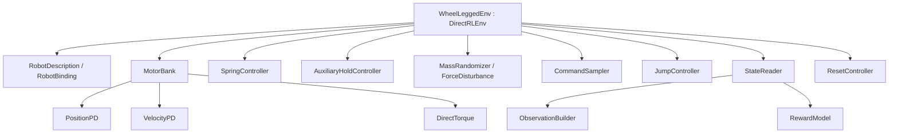

# 组合架构

环境没有多重继承，没有 `__getattr__` 转发，没有把旧类函数动态挂到新类上。
组件显式接收它需要的对象和配置，避免依赖整个巨型 env 的隐藏字段。

## 生命周期与写入所有权

| 调用位置 | 组件行为 | 频率 |
| --- | --- | --- |
| `_setup_scene` | 构建机器人、平面、接触传感器 | 启动 |
| 环境初始化 | 名称绑定、名义质量/惯量快照、组件缓冲区 | 启动 |
| `_pre_physics_step` | 接收动作、推进动作延迟和扰动计时 | 控制步 0.02 s |
| `_apply_action` | 策略电机 PD/限幅、弹簧力、辅助关节保持、外力写入 | 物理步 0.005 s |
| `_get_dones` | 读取测量快照、推进跳跃、判定终止 | 每个控制步一次 |
| `_get_rewards` | 按当前指令计分；再采样下一步指令 | 每个控制步一次 |
| `_get_observations` | 构造观测；不推进命令或跳跃计时 | 读取 |
| `_reset_idx` | 记录统计、复位所有关节、清空局部历史和外力 | 指定 env 子集 |

所有策略关节的力矩只能由 `MotorBank` 写。弹簧关节由 `SpringController` 写。
`auxiliary_holds` 中的关节仅由 `AuxiliaryHoldController` 写，Isaac 执行器为零 PD；其余辅助关节仍由阻尼执行器处理。
外部 wrench 只能由 `ForceDisturbance` 写；后续加入第二种扰动时，应先组合再统一提交。
质量和惯量只能由 `MassRandomizer` 修改；名义值保留不变。

## 机器人索引

`RobotBinding` 分别从 `robot.joint_names`、`robot.body_names`、`contact_sensor.body_names`
解析索引。传感器的接触下标不能用于 articulation 的刚体位置下标。
动作顺序由 JSON 的 motor group 顺序和组内 joints 顺序确定，不依赖 PhysX 的内部排序。
v2 的 30 个 DOF 由 `joint_names` 明确列出；所有关节必须有唯一控制归属和唯一复位值。
`directions` 定义策略到物理关节的符号变换，观测和 Critic 力矩返回策略坐标。

## 观测契约

受控关节数记为 A。

- Actor：`17 + 3A`。当前 A=6，对应 35 维。
- Critic：`30 + 5A`。当前为 60 维。
- Critic 额外看到真实速度、机身高度、双轮接触、电机力矩、质量缩放、外力和电机强度。
- Actor 的速度控制关节位置置零；当前轮子不使用无限累积转角。
- `observation_schema.json` 记录版本、字段、动作名、方向、电机模式、尺度、资产哈希、静息位姿、几何尺寸、弹簧及辅助保持配置。

仅维度相同不足以安全复用权重。旧环境没有此契约，迁移权重必须另做明确的映射和验证。
`--allow_auxiliary_change` 只允许辅助保持配置不同，其余契约仍严格匹配；用于显式微调或诊断，不用于恢复旧优化器状态。

## 姿态目标与指标

保留原 `upright`，在 IDLE/LAND 阶段增加 roll²、pitch²、roll/pitch 角速度平方惩罚。
PUSH/FLIGHT 阶段不施加这三个新增项，跳跃阶段调度保持原样。
日志直接给出 roll/pitch/总倾角 RMS（度）、左右轮中心高度差 RMS（米）及双轮接触比例。
指标按实际测量时间累计，子集复位只清理对应环境的累积值，不受初始随机回合计时影响。

## 跳跃

`IDLE → PUSH → FLIGHT → LAND → IDLE`。
每次起跳清空本次峰值和离地记录。真实起跳需要向上速度、双轮几何离地和无接触持续一段时间。
落地成功要求双轮接触、姿态、速度和站高稳定；超时退出不算成功。
计时只在 `_finish_step` 里推进，读取观测不会使阶段时间加倍或清空奖励事件。
初版采用原地跳跃；行进跳跃需要独立的命令/落地容差设计。
